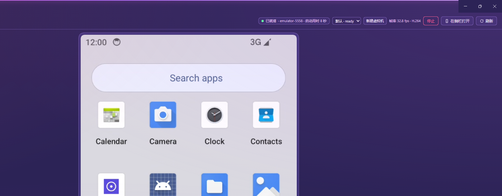
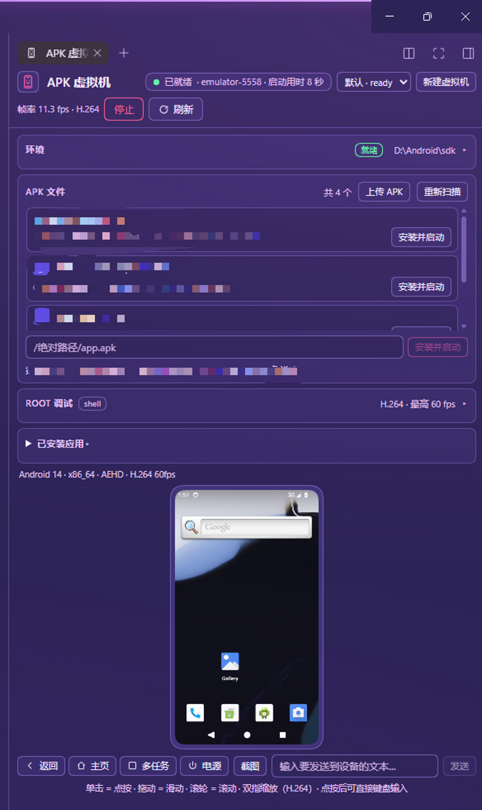

# APK Virtual Machine — a DeepSeek Harness plugin

[](https://github.com/yuxiaole-bili/dsh-apk-vm/actions/workflows/ci.yml)
[](https://www.npmjs.com/package/dsh-apk-vm)
[](LICENSE)
[](https://github.com/yuxiaole-bili/dsh-apk-vm)
[](https://dsh-plugin.org/plugins/yuxiaole-bili/dsh-apk-vm)

**Run a real Android APK inside a local, rooted, open-source Android VM and preview it in the DeepSeek Harness sidebar — streamed as H.264/WebCodecs video at up to 60 fps.**

This repository contains the static DSH plugin `dsh-apk-vm`. It adds a first-class sidebar
entry ("APK Virtual Machine" / "APK 虚拟机") whose main panel boots an AOSP Android Emulator,
installs an APK into the guest, streams the guest display into the panel, and forwards
tap / swipe / key / text input back into the VM. The guest is a `userdebug` image prepared for
root (`adb root` on every boot), and the plugin exposes that rooted device to DSH through a
same-origin, loopback-only debug HTTP API and an `apk_vm` Agent tool.

> **中文简介**：在 DeepSeek Harness 的侧边栏里预览 Android APK。插件会启动本地开源
> AOSP Android 虚拟机（Android 14 / API 34，`system-images;android-34;default;x86_64`），
> 安装 APK，并通过 scrcpy H.264 + WebCodecs 把画面串流到侧边栏（最高 60 fps），同时把
> 点击、滑动、按键、文本输入送回虚拟机。支持拖拽 APK 上传、环境自检卡片、root 调试
> API 与 `apk_vm` Agent 工具；多个 Agent 可各自使用独立的隔离虚拟机实例（多开）。
> 参考机上冷启动约 29.5 s、快照快速启动约 8.4–10.5 s。
> 当前 **Windows x64 与 Linux x86_64（headless）为端到端已验证平台**；macOS 仅做探测/CI
> 覆盖，详见 `docs/LINUX-E2E.md`。

**Status:** `0.4.1` · Apache-2.0 · no npm runtime dependencies · no build step.

This is an open-source DSH plugin published on npm as **`dsh-apk-vm`**. Repository:
[github.com/yuxiaole-bili/dsh-apk-vm](https://github.com/yuxiaole-bili/dsh-apk-vm).
Maintainer: [yuxiaole-bili](https://github.com/yuxiaole-bili/).
Please read [CONTRIBUTING.md](CONTRIBUTING.md), [CODE_OF_CONDUCT.md](CODE_OF_CONDUCT.md),
[SECURITY.md](SECURITY.md), [docs/PRIVACY.md](docs/PRIVACY.md) and [docs/RELEASING.md](docs/RELEASING.md) before opening issues or
releasing.

## One-line value

Turn DeepSeek Harness into a local Android APK workbench: boot a rooted AOSP VM, preview it at
up to 60 fps in the sidebar, and let Agents install, tap, inspect and debug APKs without leaving
the session.

## Install

Install the published npm package (the command used by the DSH plugin center and the community
market):

```bash
dsh plugin --profile web add dsh-apk-vm
```

For the Electron-managed Desktop profile, use **Plugins → add/install local bundle** with this
directory, or install the package through the app's plugin manager.

Source fallback without npm:

```bash
dsh plugin --profile web add github:yuxiaole-bili/dsh-apk-vm
# local clone / non-Electron profile:
dsh plugin --profile desktop add <path-to-this-clone>
```

## Capability category

**开发与运维 / Developer Tools** — Android VM lifecycle, APK install/preview, rooted debugging
and Agent-facing UI automation for development workflows.

## Risks, permissions and compatibility

**Requirements**

- Android SDK with `adb`, emulator, `sdkmanager`/`avdmanager`, a matching system image and an AVD
  (the Environment card checks all of this; SDK bootstrap is opt-in).
- Hardware virtualization: AEHD/WHPX on Windows, KVM on Linux, or HVF on macOS.
- Node.js ≥ 20 only for the repository's headless checks; the plugin itself has no npm
  dependencies or build step.
- Each running VM costs roughly 2.5 GB RAM; `maxInstances` defaults to 3 extra VMs.

**Permissions / risk**

- The guest is intentionally `userdebug` and rooted (`adb root` on boot); do not put secrets or
  personal data in the AVD.
- `apk_vm` is registered for every Agent in the profile and exposes guest root shell, app
  install/uninstall, UIAutomator and input injection. Grant it the same trust as a terminal on a
  rooted Android device.
- `/apk-vm/*` HTTP routes and WebSocket upgrades are same-origin and **loopback-only by
  default**; `allowRemote: true` is an explicit opt-in for use behind a trusted authenticated
  proxy.
- No telemetry. Network access only occurs for explicit SDK/system-image downloads through the
  user's `sdkmanager`, or when the user configures a remote adb device.

**Compatibility**

- Tested with DSH Desktop `0.2.1-rc.3` (static bundle/plugin APIs).
- Windows x64 and Linux x86_64 (headless, KVM + SwiftShader) are verified end-to-end
  (boot, H.264, rooted debug, APK install, Agent tool). macOS has SDK discovery + headless CI
  coverage but no live emulator run in this repository.
  See [docs/LINUX-E2E.md](docs/LINUX-E2E.md).
- Optional integration with
  [`dsh-better-sidebar`](https://github.com/omdsh-dev/DSH-better-sidebar); the plugin falls back
  cleanly when that service is absent.
- AOSP Android 14 / API 34, x86_64 system image; physical/remote adb devices can be attached
  instead of the AVD.

---

## Demo / visible proof

Real screenshots from the reference host:





| Asset | Status |
| --- | --- |
| `docs/screenshot-panel.png` | ✅ main panel: Environment, guest H.264, controls |
| `docs/screenshot-sidebar.png` | ✅ right-sidebar layout next to a session |
| `docs/demo.gif` | optional — record a 20–30 s demo on a real host |

The [Performance](#performance) and [Verification](#verification) sections list exactly what was
measured, on which host, and how. Real `apk_vm` output from the reference run:

```text
find_ui {"text":"Phone"}  -> Phone @ 102,1121
assert_text {"text":"Phone"} -> found 1 matching UI node(s)
tap_text {"text":"Phone"} -> tapped Phone at 102,1121
key {"text":"HOME"}       -> returned to launcher
```

---

## Features

- **Sidebar entry + main panel.** Registers a localized sidebar item (`sidebar.panellist`,
  id `apk-vm`, order 30) with a phone glyph ([icon.svg](icon.svg)), plus a full center-column
  panel (`main`, key `apk-vm`). Both are live-verified in the reference profile.
- **Environment self-check card.** A one-glance readiness report for the host — SDK, `adb`,
  emulator, command-line tools (`sdkmanager`/`avdmanager`), the configured system image, the
  AVD, and CPU acceleration — with the missing pieces and the available repair actions
  (`GET/POST /apk-vm/setup`). The card can create the AVD when the system image is already
  installed, and — when `allowSetupDownloads: true` — install missing SDK components, or
  **bootstrap a completely empty host** (download Google command-line tools, extract, accept
  licenses, install platform-tools/emulator/build-tools/platform).
- **Multi-agent isolation / multi-instance.** Several DSH Agents can drive separate VMs at the
  same time: the first Agent gets the default VM, later Agents are assigned isolated instances
  with their own AVD, emulator port, snapshot, debug state and **H.264/WebCodecs stream**
  (`maxInstances`, default 3 extra; extra VMs use a 720×1280 preview display).
  Extra instances expose `owner` / `lastUsedAt` / `idleMs`, and are **stopped automatically**
  after `instanceIdleMs` without panel frames, stream clients or Agent commands (AVD kept for
  quick reuse). The panel selector and **VM instances** card show owner/idle state and offer
  Stop/Destroy. The `apk_vm` tool accepts
  `instance` and exposes `list_instances` / `create_instance` / `destroy_instance`.
- **Multi-AVD switching.** The Environment card lists the AVDs visible to the emulator and can
  switch (`GET /apk-vm/avds`, `POST /apk-vm/avd`); the current AVD is stopped, switched and
  restarted automatically.
- **APK upload by button or drag-and-drop.** The panel has an **Upload APK** button and a
  drop overlay on the screen area; the file is posted to `/apk-vm/upload`
  (raw APK bytes, ≤ 500 MiB, `.apk`/ZIP magic checked), installed into the running VM and
  launched. Uploaded files live in the OS temp dir and are cleaned up when the plugin is
  disposed. Installing by absolute local path is still available (`/apk-vm/install`).
- **APK bundles: APKS / XAPK / split APKs.** The Upload APK flow accepts `.apk`, `.apks`
  (bundletool output) and `.xapk` files; split APKs are extracted to a temp directory and
  installed with `adb install-multiple`. Plain `.apk` still uses `adb install -r`.
  `.aab` is rejected with a clear "build APKs with bundletool first" message.
- **UI Inspector + selector generation.** Toggle **Inspect UI** in the panel to overlay
  clickable UIAutomator nodes on the live screen. Selecting a node shows its text, resource id,
  class and bounds and gives copy-ready `tap_text` / `assert_text` commands for the `apk_vm`
  tool. Also available to Agents as the `inspect_ui` action.
- **Interaction recorder / replay.** Start a recording, use the panel or Agent tool normally,
  then save the tap / swipe / key / text sequence as a JSON flow under the OS temp directory.
  Flows can be listed, replayed with their original relative timing, downloaded or deleted.
  Agents get `flow_start`, `flow_stop`, `flow_list` and `flow_replay`.
- **Network debugging: proxy + CA.** The Network card sets/clears the guest global HTTP proxy
  (`settings put global http_proxy`) and installs a local `.pem`/`.crt` CA into the rooted
  Android user CA store with the correct OpenSSL subject-hash filename; the system CA store is
  updated when the guest allows a remount.
- **Installed-app management.** The panel's **Installed apps** card lists third-party packages
  for the active instance and offers force-stop, clear-data and uninstall; it uses the same
  rooted `debug/packages` + `debug/action` API as the Agent tool.
- **Optional [`dsh-better-sidebar`](https://github.com/omdsh-dev/DSH-better-sidebar) tab.**
  When that community plugin is installed, this plugin registers a real tab type
  (`apk-vm:preview`) through its service — no fork, no DOM hacks, and it degrades cleanly when
  the service is absent (see [compatibility](#compatibility-with-dsh-better-sidebar)).
- **VM lifecycle from the UI.** Start / stop / restart the AVD or save a snapshot; the
  Environment card lists all adb devices (emulator, USB/physical, network) and can attach one at
  runtime. Detach restores the managed AVD identity. Live state, serial, boot mode/time, and a
  bounded diagnostic log are shown.
- **APK discovery + one-click install.** Recursively finds `*.apk` under the configured roots,
  reads package name / label / launcher activity with `aapt2 dump badging`, then runs
  `adb install -r` and launches the app with `am start`.
- **Static APK preview.** `GET /apk-vm/apk-info?path=…` reports version, min/target SDK,
  permissions, native ABIs, features and launcher activity without starting the VM;
  `GET /apk-vm/apk-icon?path=…` extracts the raster launcher icon directly from the APK ZIP.
  The APK list shows icons when a raster icon is present.
- **Live H.264 stream, up to 60 fps.** Default transport is scrcpy 5.0.1 H.264 over the
  same-origin WebSocket `/apk-vm/ws`, decoded with `WebCodecs VideoDecoder` onto a `<canvas>`
  (configured for 60 fps, 540×960, 6 Mbps). Late clients get a `RESET_VIDEO` keyframe request.
  If `WebCodecs` / `WebSocket` is unavailable, the panel falls back to `adb exec-out screencap -p`
  PNG polling (target 1–10 fps).
- **Full input forwarding.** Click → tap, drag → swipe, wheel → swipe, **two-finger pinch/zoom**
  via the scrcpy control socket, plus Home / Back / Recents / Power and a text field; after
  clicking the screen, common hardware keys (arrows/Enter/Escape/Tab/Backspace/Delete) and
  printable characters are forwarded as Android key/text input. Clipboard text can be written to
  the device (scrcpy `SET_CLIPBOARD`) or read back (`GET_CLIPBOARD`). Coordinates are converted
  from the rendered phone frame to the device resolution.
- **Rooted debug surface + extra device tools.** Auto `adb root` after every boot, an on-device
  toolkit at `/data/local/tmp/dsh/debug.sh`, a same-origin debug HTTP API, and an `apk_vm`
  Agent tool every DSH agent can call: root shell, logcat, props, packages, install, push/pull,
  reboot, force-stop / clear-data / uninstall, screenshot, **rotate**, **UIAutomator UI tree**,
  **5-second screen recording (pulled to the host temp dir)** and **performance snapshot**.
- **Fast start.** Hypervisor detection (AEHD / WHPX / KVM / HAXM / HVF), host GPU rendering,
  quick-boot snapshots, prewarm and auto-start — measured **cold 29.5 s**, **quick boot
  8.4–10.5 s** on the reference host ([details](#fast-start-four-layers)).
- **Cross-platform SDK discovery.** `lib/setup.js` and `lib/android.js` discover Android SDK,
  `adb`, the emulator and AVDs across Windows, macOS and Linux layouts (including `.exe`
  suffixes and per-OS fallback locations). Windows x64 and **Linux x86_64 headless** are
  verified end-to-end; see [docs/LINUX-E2E.md](docs/LINUX-E2E.md).
- **Same-origin only.** Every `/apk-vm/*` HTTP route and the `/apk-vm/ws` upgrade rejects
  cross-origin requests; request bodies and command output are bounded, and host processes are
  spawned with argv arrays (never a shell string).
- **Themed + localized.** All chrome uses `--dsw-alias-*` theme tokens; English and 简体中文
  are bundled in [locale/](locale).
- **Dependency-free backend.** The Host half uses Node built-ins only: no npm dependencies,
  no build step.

---

## UI Inspector and flow recorder

- `GET /apk-vm/debug/inspect` (and `/apk-vm/instances/<id>/debug/inspect`) returns the parsed
  UIAutomator nodes with bounds, labels, and generated `find_ui` / `assert_text` / `tap_text`
  commands. The panel's **Inspect UI** button renders the same data as an overlay.
- `GET|POST /apk-vm/flows` (and `/apk-vm/instances/<id>/flows`) lists, starts, stops, replays
  and deletes recorded flows. The panel has a **Flow recorder** card with the same actions.
- `apk_vm` actions: `inspect_ui`, `flow_start`, `flow_stop`, `flow_list`, `flow_replay`.
- `POST /apk-vm/debug/proxy` sets the guest HTTP proxy; `DELETE` clears it.
- `POST /apk-vm/debug/ca` accepts a host `.pem`/`.crt` path and installs it under the guest's
  user CA directory with the correct subject hash.

## Reproducible demo

A public, dependency-free demo lives in [examples](examples/README.md):

```bash
node examples/demo.mjs
```

It installs the committed MIT-licensed 12 KB sample APK (`dev.dsh.sample`), reads the
UIAutomator tree, taps **Say hello**, asserts that the screen now says
`Hello from dsh-apk-vm`, and saves a 720×1280 screenshot to `examples/demo-out/`. No personal
APK, private key or host-specific path is required.

---

## Quickstart

### 1. Prerequisites

| Requirement | Notes |
| --- | --- |
| **DeepSeek Harness** | A profile that can install local plugin bundles (the desktop Web UI or any agent with the `plugin_manager` tool). |
| **Android SDK** | `platform-tools` (adb), `emulator`, `build-tools` (for `aapt2`), command-line tools (`sdkmanager`/`avdmanager`) and an AOSP system image. A JDK (17 works) is needed by the SDK command-line tools. |
| **AOSP system image** | `system-images;android-34;default;x86_64` (Android 14, API 34) — the image used for all measurements below. Configurable with `systemImage`. |
| **Hardware virtualization** | Required for the x86_64 image: AEHD or WHPX on Windows, KVM on Linux, HVF on macOS. See [acceleration matrix](#cpu-acceleration-matrix). |
| **Disk / RAM** | A few GB for the SDK + system image and the AVD; an emulator with a modern desktop GPU is recommended. |
| **Node.js 24+** *(optional)* | Only for running this repository's checks ([Verification](#verification)). The plugin itself has no npm dependencies. |

The plugin's **Environment** card performs this check for you (see
[First run](#5-first-run)); the commands below are the manual equivalent.

#### CPU acceleration matrix

| Host OS | Backend | How to enable |
| --- | --- | --- |
| Windows | **AEHD** (Android Emulator Hypervisor Driver) | Install via SDK Manager package `extras;google;Android_Emulator_Hypervisor_Driver`, or the standalone installer; requires administrator rights and a reboot. Recommended when Hyper-V/WHPX is **not** active. |
| Windows | **WHPX** | Enable the *Windows Hypervisor Platform* optional feature (and Hyper-V if desired), reboot. Alternative when Hyper-V is already in use. |
| Linux | **KVM** | Load `kvm_intel`/`kvm_amd`, ensure `/dev/kvm` exists and your user can access it (e.g. `kvm` group), then reboot/login again. |
| macOS | **HVF** (Hypervisor.framework) | Built into macOS; the emulator uses it automatically on Intel and Apple Silicon hosts. |

Check the host before starting the plugin:

```bash
"$ANDROID_HOME/emulator/emulator" -accel-check
```

The plugin also runs the SDK's `emulator-check accel` itself and reports the result in
`/apk-vm/state` (`vm.accel`), `/apk-vm/setup` (`accel`) and the panel log. If no hypervisor is
usable, it **fails fast** with an explicit error instead of hanging for 20 minutes (the x86_64
image cannot boot under pure TCG).

### 2. Install the plugin

Copy or clone this repository anywhere local:

```bash
git clone https://github.com/yuxiaole-bili/dsh-apk-vm.git
cd dsh-apk-vm
```

Then pick one:

- **CLI npm install (community market / non-`desktop` profile)**:
  ```bash
  dsh plugin --profile web add dsh-apk-vm
  ```
  Source fallback: `dsh plugin --profile web add github:yuxiaole-bili/dsh-apk-vm`.
- **DSH Web UI** — open **Plugins**, choose to add/install a plugin bundle from a local
  directory, and select this folder. The bundle patch is [cordis.patch.yml](cordis.patch.yml);
  the `dsh.client` declaration in [package.json](package.json) loads `client.js` into the Web UI.
- **Agent tool** — ask a DSH agent to run `plugin_manager` with action `install_bundle` and the
  target set to this folder path.
- **CLI local install (non-Electron profiles only)** —
  `dsh plugin --profile <profile> add <path-to-this-folder>`. The Electron-managed `desktop`
  profile must be managed from the app UI instead.

After installing or upgrading the plugin, **reload the DSH Web page** so the new client bundle
is loaded.

### 3. Provide an Android SDK, system image and AVD

The plugin auto-discovers the SDK (`sdkRoot`, `ANDROID_HOME`, `ANDROID_SDK_ROOT`, then common
per-OS locations) and adb/emulator. Fastest path: open the panel, check the **Environment**
card, and use **Create AVD** once the system image is installed. If the image is missing and
`allowSetupDownloads: true` is set, the card can also run `sdkmanager --install` for it;
otherwise install it yourself:

```bash
sdkmanager --install "platform-tools" "emulator" "build-tools;34.0.0" \
  "system-images;android-34;default;x86_64"
avdmanager create avd -n dsh_apk -k "system-images;android-34;default;x86_64"
```

The plugin can also attach to an already-running adb device instead of spawning the AVD; set
`serial` (for example `emulator-5558` or `<device-ip>:5555`) and leave `emulatorPath`/`avdName`
unset.

### 4. Configure

The bundle ships with portable defaults (SDK auto-detection, `avdName: dsh_apk`). Review the
config for your machine — at minimum `roots` if you want extra APK scan directories. The full
list of keys is in the [configuration reference](#configuration).

```yaml
config:
  # sdkRoot: 'C:/Android/sdk'       # optional; otherwise auto-detected
  # emulatorPath: 'C:/Android/sdk/emulator/emulator.exe'  # optional; auto-detected
  # serial: 'emulator-5558'        # ...or attach an existing adb serial instead of spawning
  systemImage: 'system-images;android-34;default;x86_64'
  avdName: dsh_apk
  port: 5558
  roots: ['C:/projects']           # extra APK discovery roots (workspace is automatic)
  gpuMode: host
  accel: auto
  requireAccel: true
  quickBoot: true
  snapshotName: default_boot
  saveSnapshotAfterBoot: true
  prewarm: false                   # opt-in warm boot on plugin activation
  prewarmDelayMs: 3000
  autoStart: true
  multiInstance: true              # isolated VMs for concurrent agents
  maxInstances: 3                  # extra VMs (default VM is always available)
  instanceIdleMs: 900000           # stop idle extra VMs after 15 min (AVD kept)
  instanceReapIntervalMs: 60000
  allowRemote: false               # reject non-loopback VM API clients
  allowSetupDownloads: false       # gate the optional system-image download action
  scrcpy: true
  scrcpyMaxSize: 960
  scrcpyMaxFps: 60
  scrcpyBitrate: 6000000
  frameFps: 2                      # only the PNG fallback target (1-10)
```

If `emulatorPath` / `adbPath` are omitted, the plugin auto-discovers the Android SDK from
`sdkRoot`, then `ANDROID_HOME` / `ANDROID_SDK_ROOT`, then common per-user/system install
locations, and finally falls back to `PATH`. Spawning an AVD still needs `avdName`; use `serial`
to attach an existing device instead.

### 5. First run

1. Open the DSH sidebar and click **APK Virtual Machine**. Check the **Environment** card:
   green **Ready** means the SDK, image, AVD and acceleration were found; **Setup needed** lists
   what is missing and offers **Create AVD** (and optionally **Download image** when
   `allowSetupDownloads: true`).
2. Press **Start VM** (or let `prewarm`/`autoStart` boot it). The **first start is a cold boot**
   (measured 29.5 s on the reference host); the plugin then saves the quick-boot snapshot
   `default_boot`, and later starts restore it (measured 8.4–10.5 s).
3. Install an APK: click **Upload APK**, drag an `.apk` file onto the panel, or pick one from the
   discovered list / install by absolute path. The app is installed and launched automatically.
   Use the phone frame for input and the **Rooted debug** card for root shell, logcat, props,
   UI tree, rotation, recording, perf and screenshot.
4. Or delegate to an agent, for example: *"Use the `apk_vm` tool to install
   `C:/work/app.apk` and take a screenshot."*

---

## Configuration

All keys are optional; defaults are shown in the **Default** column.

| Key | Default | Purpose |
| --- | --- | --- |
| `emulatorPath` | auto-detected | Path to the Android emulator executable. Auto-discovered from the SDK / `PATH`. |
| `avdName` | — | AVD name to spawn. Required to spawn an AVD. |
| `serial` | — | Attach this adb serial instead of spawning an emulator. |
| `port` | `5558` | Emulator console port used when spawning. |
| `sdkRoot` | `ANDROID_HOME` / `ANDROID_SDK_ROOT` | Android SDK root for `adb`, `aapt2`, `emulator-check`, `sdkmanager`/`avdmanager`. |
| `adbPath` | `<sdk>/platform-tools/adb` | Explicit adb executable. |
| `systemImage` | `system-images;android-34;default;x86_64` | System image required by the Environment card and used for AVD creation. |
| `spawnEmulator` | `true` | Set `false` to only attach (never spawn). |
| `emulatorArgs` | `[]` | Extra argv appended to the emulator command line. |
| `roots` | `[]` | Extra APK discovery roots. The DSH working directory, `process.cwd()` and the home directory are added automatically. |
| `bootTimeoutMs` | `1200000` | Max wait for the guest to report `sys.boot_completed=1`. |
| `gpuMode` | `host` | `host` uses the real GPU; `swiftshader_indirect` is the software fallback for headless hosts. |
| `accel` | `auto` | `auto` detects AEHD/WHPX/KVM/HAXM/HVF; `on`/`off` force the decision. |
| `requireAccel` | `true` | Fail fast with an explicit error when no hypervisor is found, instead of booting forever under TCG. |
| `quickBoot` | `true` | Restore the saved AVD snapshot when present; `false` adds `-no-snapshot`. |
| `snapshotName` | `default_boot` | Snapshot name to load/save. |
| `saveSnapshotAfterBoot` | `true` | Save a snapshot after the first successful cold boot. |
| `prewarm` | `false` | Boot the VM in the background shortly after plugin activation. |
| `prewarmDelayMs` | `3000` | Delay before the prewarm start. |
| `autoStart` | `true` | Start the VM on the first `/apk-vm/state` or `/apk-vm/frame` request. |
| `multiInstance` | `true` | Allow isolated extra VMs for concurrent Agents. |
| `maxInstances` | `3` | Maximum number of extra instances (in addition to the default VM). Each running instance costs guest RAM/CPU. |
| `instanceIdleMs` | `900000` | Stop an extra instance after this long without panel frames, a video client, or an Agent command (AVD is kept). |
| `instanceReapIntervalMs` | `60000` | How often the idle reaper checks extra instances. |
| `allowRemote` | `false` | Allow non-loopback clients to reach `/apk-vm/*` and `/apk-vm/ws` (only behind your own authenticated proxy). |
| `allowSetupDownloads` | `false` | Allow the Environment card's `install-image` action to run `sdkmanager --install` (large download). |
| `frameFps` | `2` | PNG fallback target frame rate, 1–10 (the H.264 path is not affected). |
| `scrcpy` | `true` | Enable the H.264/WebCodecs transport. |
| `scrcpyMaxSize` | `960` | Encoder max size; 960 yields 540×960 video. |
| `scrcpyMaxFps` | `60` | Encoder frame-rate cap, 1–60. |
| `scrcpyBitrate` | `6000000` | Video bitrate in bits/s. |
| `scrcpyPort` | `27183` | Local adb-forward port for the scrcpy server tunnel. |
| `scrcpyJarPath` | vendored JAR | Override the scrcpy server JAR path. |

The Environment report (`GET /apk-vm/setup`) returns `ok`, `platform`, `sdkRoot`, `adbPath`,
`emulatorPath`, `avdmanagerPath`, `sdkmanagerPath`, `emulatorVersion`, `systemImage` +
`systemImagePresent`, `avdName` + `avdPresent` + `avdPath`, `accel { available, backend,
detail }`, `hypervisorNotes`, `missing[]` and `actions[]` with per-action availability.

---

## Architecture

```
┌────────────────────────────── DSH Web UI ────────────────────────────────┐
│ sidebar.panellist [apk-vm, order 30] ──click──▶ main[apk-vm] panel       │
│                         Client half: client.js                           │
│  Environment card · upload/drop · APK list · phone frame (WebCodecs      │
│  canvas or PNG fallback) · Rooted debug card                             │
└──────────────────────────────────┬───────────────────────────────────────┘
                                   │ same-origin HTTP + WebSocket
┌──────────────────────────────────▼───────────────────────────────────────┐
│ DSH Host: index.js  (/apk-vm/* routes, ws relay, debug API, agent tool)  │
│  ├─ lib/android.js  AndroidVm: AVD lifecycle, adb, aapt2, input, debug   │
│  ├─ lib/setup.js    Environment detection, createAvd, installSystemImage │
│  ├─ lib/scrcpy.js   ScrcpySession: push server, adb forward, H.264 demux │
│  │                  (Annex-B → AVCC), control messages (RESET_VIDEO, …)  │
│  └─ lib/ws.js       dependency-free RFC 6455 WebSocket server            │
└──────────────────────────────────┬───────────────────────────────────────┘
                                   │ adb
                    ┌──────────────▼──────────────┐
                    │ AOSP Android Emulator        │
                    │ Android 14 / API 34, x86_64  │
                    │ userdebug, adbd as root      │
                    └──────────────────────────────┘
```

| Layer | Implementation | Role |
| --- | --- | --- |
| VM | AOSP Android Emulator (`emulator` + `system-images;android-34;default;x86_64`) | Boots the open-source Android system image; driven through adb. |
| Setup | [lib/setup.js](lib/setup.js) | Dependency-free SDK / adb / emulator / AVD / acceleration detection plus one-click `create-avd` and optional `install-image`. |
| Streaming | scrcpy 5.0.1 server (`lib/vendor/scrcpy-server-v5.0.1.jar`, pushed to `/data/local/tmp/scrcpy-server.jar`) + [lib/scrcpy.js](lib/scrcpy.js) | H.264 screen capture and the scrcpy control protocol, without the desktop scrcpy client. |
| Device bridge | `adb` from Android SDK platform-tools | install / launch / screencap / input / logcat / file push-pull. |
| Plugin runtime | DSH plugin APIs (`slots`, `locale`, `webServer`, `tools`, `dsh.client`) | Sidebar entry, main panel, same-origin HTTP/WebSocket control plane, agent tool. |

No npm dependencies are used: the Host half imports only Node built-ins, `client.js` is a
pre-built browser bundle, and the plugin has no build step.

### Fast start: four layers

| Layer | What it does |
| --- | --- |
| **Hardware CPU acceleration** | Runs `emulator-check accel`; when AEHD / WHPX / KVM / HAXM / HVF is usable the emulator gets hardware virtualization. Pure TCG is never silently attempted for the x86_64 image (`requireAccel: true` fails fast with a clear error). |
| **Host GPU** | `-gpu host` renders the VM with the real GPU instead of SwiftShader; switch `gpuMode` on headless/no-GPU hosts. |
| **Quick-boot snapshot** | The first successful cold boot saves `adb emu avd snapshot save default_boot`; later starts pass `-snapshot default_boot`. A leftover `ram.img` without `snapshot.pb` is not treated as a valid snapshot. |
| **Warm start** | `prewarm: true` boots the VM ~3 s after plugin activation; `autoStart: true` boots it on the first `/apk-vm/state`/`/apk-vm/frame` request. |

`/apk-vm/state` exposes `vm.bootKind` (`cold` / `snapshot` / attach), `vm.bootMs`,
`vm.accel`, `vm.gpuMode` and `vm.snapshotAvailable`; the panel shows `cold Ns` / `quick Ns`.

### H.264 streaming and input

The default transport (when `scrcpy: true`) is:

```
scrcpy-server (guest H.264) → adb forward → ScrcpyVideoDemuxer → Annex-B→AVCC
  → /apk-vm/ws WebSocket → browser VideoDecoder → <canvas>
```

- WebSocket text frame `init`: `{ codec:"h264", codecString, description (avcC, base64),
  width, height, maxFps, bitrate }`.
- Binary frame: `[0]=1][1=keyframe flag][2..9]=pts (int64 LE)][10..]=AVCC NAL units]`.
- A client that connects to an already-running session triggers a scrcpy control
  `RESET_VIDEO` (type 17) so it receives a fresh keyframe; clients drop delta frames until the
  first keyframe so the canvas never decodes garbage.
- The session is shared by all connected clients; when the last client disconnects the scrcpy
  encoder is stopped after a grace period (the VM keeps running). Stopping/restarting the VM or
  unloading the plugin stops the stream.
- Input is independent of the streaming path: `/apk-vm/input` remains the only input channel
  (the panel does not bypass it), so input keeps working with the PNG fallback.

The protocol notes collected while implementing this against scrcpy 5.0.1 are in
[spike/scrcpy/PROTOCOL.md](spike/scrcpy/PROTOCOL.md).

### HTTP control plane (same origin, local only)

Every route rejects cross-origin requests; the WebSocket upgrade is checked the same way.
JSON bodies are bounded to 64 KiB; the raw APK upload is bounded to 500 MiB.

| Method | Path | Purpose |
| --- | --- | --- |
| GET | `/apk-vm/state` | VM state, serial, boot time/kind, accel/GPU, root/debug status, display size, current APK, stream counters, log tail. |
| GET | `/apk-vm/setup?force=1` | Environment report (SDK/adb/emulator/tools/image/AVD/acceleration, missing items, available actions). Cached ~15 s. |
| POST | `/apk-vm/setup` | `{"action":"refresh"\|"create-avd"\|"install-image"\|"install-tools"\|"bootstrap-sdk"}`. `install-tools`/`bootstrap-sdk` accept optional `packages`; all download actions require `allowSetupDownloads: true` (otherwise `403`) and are never automatic. |
| GET | `/apk-vm/apks` | Discover `*.apk` files under the configured roots. |
| GET | `/apk-vm/apk-info?path=…` | Static APK metadata (package/version/targetSdk/permissions/features/native code/launch activity/icon path) via `aapt2`. |
| GET/HEAD | `/apk-vm/apk-icon?path=…` | Extract the raster launcher icon from the APK ZIP (PNG/WebP/JPEG). |
| GET | `/apk-vm/devices` | List adb devices (`serial`, `state`, `kind`, `model`, `product`, transport) plus current/managed-device metadata. |
| POST | `/apk-vm/device` | `{"serial":"<adb-serial>"}` attach an online physical/network device; `{"serial":""}` detach and restore the managed AVD. |
| POST | `/apk-vm/vm` | `{"action":"start"\|"stop"\|"restart"\|"snapshot"}`. |
| POST | `/apk-vm/install` | `{"path":"C:/path/app.apk"}` → install + launch. |
| POST | `/apk-vm/upload` | Raw APK bytes (≤ 500 MiB) with the file name in the `x-apk-name` header → validate ZIP/APK magic, write to the OS temp dir, install + launch. |
| GET | `/apk-vm/frame?t=…` | Latest PNG frame (`409` while the VM is not ready). |
| POST | `/apk-vm/input` | `tap` / `swipe` / `key` / `text` payloads. |
| POST | `/apk-vm/touch` | Multi-touch scrcpy control (`{"action":"down\|move\|up\|cancel","pointerId":0,"x":…,"y":…}` in video-frame coordinates) for pinch/zoom. |
| GET/POST | `/apk-vm/clipboard` | Read the device clipboard (`GET`, scrcpy `GET_CLIPBOARD`) or write text (`POST {"text":…}`). |
| POST | `/apk-vm/stream` | `{"fps":1–10}` — set the PNG fallback target frame rate. |
| GET (upgrade) | `/apk-vm/ws` | WebSocket H.264 stream (see above). |
| GET | `/apk-vm/instances` | List default + extra VM instances, including `owner`, `lastUsedAt`, `idleMs`, `idleTimeoutMs`, `videoClients`. |
| POST | `/apk-vm/instances` | `{"name":"agent-a","start":true}` — create an isolated AVD/VM; every extra instance has its own H.264 stream. |
| DELETE | `/apk-vm/instances/:id` | Stop/dispose an extra instance (the default cannot be destroyed). |
| GET/POST | `/apk-vm/instances/:id/...` | Per-instance mirror of `state`, `frame`, `vm`, `input`, `install`, `upload`, `debug/*`. |

Uploaded APKs are written under `<os temp>/dsh-apk-vm-uploads` and that directory is removed
when the plugin is disposed (best-effort stale-file cleanup also runs before each upload).

---

## Rooted debug surface

The VM image is the AOSP `android-34;default;x86_64` **userdebug** build. After every boot the
Host half prepares a rooted debug environment and captures it in the quick-boot snapshot:

- **adb root by default.** `_prepareDebugSystem()` runs `adb root`, waits for adbd, and verifies
  `uid=0(root)`. The image has `ro.debuggable=1` and `ro.adb.secure=0`, so there is no adb
  authorization prompt. State reports `root: true` plus identity (`debugBuild`, `adbSecure`).
- **Debug-friendly settings.** adb/development settings enabled, package verifier and
  adb-install verification disabled, `persist.sys.usb.config=adb`, root-access property set.
- **On-device toolkit** at `/data/local/tmp/dsh/debug.sh` (+ `README.txt`, mode 755):
  `info | logs [lines] | prop <name> [value] | pkgs | install <apk> | help`.
- **Snapshot persistence.** Root state, settings and the toolkit are captured by
  `adb emu avd snapshot save default_boot`; a quick boot restores them and `adb root` is
  re-applied idempotently.
- The emulator accepts only `-prop qemu.*` arguments, so root/debug state is applied right after
  boot (not faked via a `-prop ro.*` flag) and then snapshotted.

### Debug HTTP API (same origin)

| Method | Path | Operation |
| --- | --- | --- |
| GET | `/apk-vm/debug/info` | serial, identity (Android/API/ABI/debug), root, toolkit, display, uptime. |
| POST | `/apk-vm/debug/shell` | `{"command":"id; getprop …"}` → rooted shell (bounded stdout/stderr/code). |
| GET | `/apk-vm/debug/logcat?lines=200&buffer=main&filter=…` | bounded logcat dump; `buffer=crash` for the crash buffer. |
| GET/POST | `/apk-vm/debug/prop` | read (`?name=`) / write (`{"name","value"}`) system properties. |
| GET | `/apk-vm/debug/packages` | third-party (or `?all=1` all) packages with APK paths. |
| POST | `/apk-vm/debug/root` | ensure adbd is root. |
| POST | `/apk-vm/debug/push` | `{"localPath","remotePath"}` (remote under `/data/local/tmp`, `/sdcard`, `/storage/emulated/0`). |
| POST | `/apk-vm/debug/pull` | `{"remotePath","localPath"}` (local confined to APK roots + temp). |
| POST | `/apk-vm/debug/reboot` | `{"mode":"system"\|"recovery"\|"bootloader"}`. |
| POST | `/apk-vm/debug/action` | `force-stop` / `clear-data` / `uninstall` by package name. |
| POST | `/apk-vm/debug/rotate` | `{"orientation":"portrait"\|"landscape"\|"left"\|"right"\|"upside-down"}` or rotation `0..3`; locks the guest rotation. |
| GET | `/apk-vm/debug/ui` | UIAutomator hierarchy XML (bounded to 500 000 chars) plus node count and guest remote path. |
| POST | `/apk-vm/debug/record` | `{"seconds":1–60}` (default 5) → `screenrecord` MP4 pulled to the host temp dir; returns `localPath` and byte size; the panel auto-downloads it. |
| GET | `/apk-vm/artifacts?name=…` | Download a screenshot/recording previously written by the plugin into the OS temp dir (basename whitelist, no arbitrary paths). |
| GET | `/apk-vm/debug/perf` | load average, `/proc/meminfo` totals/free/available and the first lines of `dumpsys cpuinfo`. |
| GET/HEAD | `/apk-vm/debug/screenshot` | PNG download (`Content-Disposition: attachment`). |

### Agent tool `apk_vm`

Registered globally through `ctx.tools`, so every DSH agent can operate the rooted VM directly:
`info`, `shell`, `logcat`, `getprop`, `setprop`, `packages`, `install`, `push`, `pull`,
`reboot`, `root`, `force_stop`, `clear_data`, `uninstall`, `rotate`, `ui_dump`, `record`, `perf`,
`screenshot`, high-level input `tap` / `swipe` / `long_press` / `key` / `text` (device coordinates),
UI automation `find_ui` / `assert_text` / `tap_text` (UIAutomator text/resource-id/content-desc/class),
clipboard `clipboard_get` / `clipboard_set`,
static `apk_info` (metadata without booting a VM),
device management (`devices`, `attach_device`, `detach_device`),
plus `start` / `stop` and instance management (`list_instances`, `create_instance`,
`destroy_instance`). It calls the same Host methods as the HTTP routes and the panel (no
duplicated logic).

For concurrent Agents, pass `instance` to target a specific VM; when omitted, the tool resolves
the calling Agent's assigned instance (first Agent → default VM, later Agents → isolated
instances created on demand until `maxInstances`). Each extra instance has its own H.264
WebSocket (`/apk-vm/instances/<id>/ws`) and falls back to PNG if WebCodecs is unavailable.

UI automation is live-verified against a multi-instance VM: `find_ui {"text":"Phone"}` returned
`Phone @ 102,1121`, `assert_text {"text":"Phone"}` found one node, `tap_text {"text":"Phone"}`
tapped that center and opened the app, and `key HOME` returned to the launcher.

### Panel UI

The APK VM panel has an **Environment** card (readiness, missing items, Create AVD / Download
image / Re-check) and a **Rooted debug** card: root/shell badge, Android/API/ABI line, rooted
command input (equivalent to `adb shell`), Logcat / **Live logcat** / **Crash log** / Props / Root /
**UI tree** / **Perf** /
**Record 5s** / **Rotate** / **Screenshot** buttons, and a bounded output console.

---

## Compatibility with dsh-better-sidebar

[dsh-better-sidebar](https://github.com/omdsh-dev/DSH-better-sidebar) is the community sidebar
workbench (right-sidebar tabs, bottom workbench, file viewers). When it is active, this plugin
registers a real tab type through its documented service — no forks, no DOM hacks, no hard
dependency:

- The client half defers with `ctx.inject(['betterSidebar'], …)`, so the plugin keeps working
  unchanged on a plain DSH and simply gains the tab when the service appears.
- `ctx.betterSidebar.registerTab({ id: 'apk-vm:preview', title, description, icon, order: 60,
  single: true, component })` — the tab appears in the native right Sidebar's **+** menu and in
  the bottom workbench, rendered with the same VM console adapted to a narrow pane (stacked APK
  list, compact header, `visible`-gated frame polling).
- The main panel gains an **"Open in side bar"** action that calls
  `ctx.betterSidebar.openTab({ type: 'apk-vm:preview', target: 'right' })` for the active
  session (with a clear message when no session is open).
- Everything degrades cleanly: the service is optional, and a missing/broken service never
  affects the native `main` panel or the left sidebar entry.

Live-verified in the reference profile: the `sidebar.right.pane.tab` slot lists the occupant
`dsh-better-sidebar:apk-vm:preview` (`active: true`). The sandbox test
[spike/ui-better-sidebar-smoke.cjs](spike/ui-better-sidebar-smoke.cjs) separately asserts
descriptor fields, localization, disposal, the "already present" path, and resilience when the
service disappears.

---

## Performance

Measured on the **reference host**: Windows x64, AEHD 2.2 hardware acceleration, `-gpu host`
(NVIDIA RTX 5070 Ti), AOSP `system-images;android-34;default;x86_64` (Android 14 / API 34).
These are observations from a single machine, not universal guarantees.

| Metric | Result |
| --- | --- |
| Cold boot (first boot; also after re-saving the snapshot for the current AVD config) | **29.5 s** |
| Quick boot (snapshot restore) | **8.4 s** measured (`Boot completed in 8371 ms`, `bootKind: snapshot`); **8.4–10.5 s** across runs — inside the 30 s target |
| Raw H.264 stream over `/apk-vm/ws` (60 Hz animation test app) | **~59.3 fps** (425–474 packets in 8 s, zero protocol errors) |
| Headless browser software WebCodecs decode | **318 frames / 6.32 s = 50.3 fps** (~57 fps excluding ~0.7 s startup) |
| Late second client (keyframe recovery) | **234 packets / 4 s (~58.5 fps)** after `RESET_VIDEO` |
| PNG `screencap` fallback | **~1.1 fps** at 720×1280 (transport limit; not a regression) |
| Rooted guest | `adb shell id` = `uid=0(root)`; `ro.debuggable=1`; `ro.adb.secure=0`; toolkit installed (755) |

FPS is **content-driven**: scrcpy only emits frames when the screen changes, so a static home
screen legitimately shows a low FPS. The 60 Hz animation test sustains ~59 fps over the wire.
The `Target FPS` selector applies only to the PNG fallback; the H.264 path is capped by
`scrcpyMaxFps`.

---

## Verification

### Automated checks (CI)

[.github/workflows/ci.yml](.github/workflows/ci.yml) runs on `ubuntu-latest` with Node.js 24 on
every push and pull request (full headless suite), plus a **cross-platform headless matrix**
(`ubuntu-latest`, `windows-latest`, `macos-latest`) that runs syntax checks, setup detection,
instance lifecycle and the UI bundle smoke test:

- `node --check` on `index.js`, `client.js` and every `lib/*.js` module;
- [spike/ui-smoke.cjs](spike/ui-smoke.cjs) — 136 sandbox assertions against the real client
  bundle (module wrapper, registration, i18n, rendering states, POST handlers);
- [spike/ui-better-sidebar-smoke.cjs](spike/ui-better-sidebar-smoke.cjs) — descriptor /
  localization / disposal / fallback assertions for the optional integration;
- [spike/setup-smoke.mjs](spike/setup-smoke.mjs) — 30 hermetic environment-detection /
  create-avd / install-image / setup-report checks (mocked OS layouts and `exec`, no SDK needed);
- [spike/android/mock-device.mjs](spike/android/mock-device.mjs) — device critical path against
  a mock adb (24 checks), including real `aapt2` APK metadata parsing;
- [spike/android/launch-plan.mjs](spike/android/launch-plan.mjs) — fast-boot argv plans
  (snapshot restore, fail-fast without a hypervisor, explicit TCG, `-no-snapshot`).

**No Android emulator or AVD is required in CI.** Emulator-dependent integration tests are
**Windows-local only** and are not suitable for hosted CI runners (nested virtualization is not
available on GitHub-hosted runners).

### Reference-host verification

| Check | Result |
| --- | --- |
| Bundle install via DSH `plugin_manager install_bundle` | `application: applied`, no warnings |
| Sidebar registration (`sidebar.panellist`, id `apk-vm`, order 30) | active in the live slot tree |
| Main panel registration (`main`, key `apk-vm`) | active in the live slot tree |
| `GET /apk-vm/state` / `GET /apk-vm/apks` | `200 {"ok":true,…}`; discovered the workspace `sample.apk` and user APKs |
| `GET /apk-vm/frame` while stopped | `409` with JSON error (as specified) |
| Client bundle | `node --check` OK; 136/136 sandbox checks pass |
| dsh-better-sidebar tab | live `sidebar.right.pane.tab` occupant `dsh-better-sidebar:apk-vm:preview`; smoke test passes |
| Host/backend modules | `node --check` OK; `lib/android.js` smoke tests 11/11; mock-device 24/24 |
| Environment detection | `spike/setup-smoke.mjs` 30/30 (hermetic, runs on CI) |
| scrcpy relay | 160 assertions incl. a fake-device end-to-end protocol test; real emulator measured ~59 fps |
| H.264 / WebCodecs | raw stream 59.3 fps; headless software decode 50.3 fps; late-client keyframe recovery works |
| Fast boot | cold 29.5 s; quick boot 8.4–10.5 s (`bootKind: snapshot`) |
| Rooted guest / debug API | `root:true`, `debugPrepared:true`; `/debug/info`, `/debug/shell`, `/debug/logcat`, `/debug/prop`, `/debug/packages`, snapshot save all returned `ok` |
| Agent tool `apk_vm` | registered through `ctx.tools`; DSH reported the updated tool schema |

The APK upload, environment card, and the added device actions (rotate / UI tree / record / perf /
screenshot download) are implemented in this release and covered by the syntax and headless
suites where applicable; the measured table above only lists values that were actually observed.
No screenshots are published yet (see [Demo](#demo)).

Run the same headless suites locally (Windows or any OS) from the repository root:

```bash
node --check index.js
node --check client.js
for f in lib/*.js; do node --check "$f"; done
node spike/ui-smoke.cjs
node spike/ui-better-sidebar-smoke.cjs
node spike/setup-smoke.mjs
node spike/android/mock-device.mjs
node spike/android/launch-plan.mjs
```

`spike/android/mock-device.mjs` needs a real `aapt2`; install Android SDK build-tools or point
`ANDROID_HOME` / `ANDROID_SDK_ROOT` at an SDK that has them.

---

## Troubleshooting

### The Environment card says "Setup needed"

The report lists each missing item: SDK path, `adb`, emulator, `sdkmanager`/`avdmanager`, the
configured system image, the AVD, or CPU acceleration.

- Missing SDK/emulator: install Android SDK packages and/or set `sdkRoot` (or `ANDROID_HOME` /
  `ANDROID_SDK_ROOT`).
- Missing system image: install it with `sdkmanager`, or set `allowSetupDownloads: true` and use
  **Download image** in the card (large download; never automatic).
- Missing AVD: use **Create AVD** in the card (requires the system image and `avdmanager`) or run
  `avdmanager create avd -n dsh_apk -k "system-images;android-34;default;x86_64"`.
- Missing acceleration: see the next section.

### "No usable CPU hypervisor (AEHD/WHPX) was found"

The plugin fails fast (`requireAccel: true` by default) because an x86_64 system image cannot
boot under pure software TCG. Check with `"$ANDROID_HOME/emulator/emulator" -accel-check`, then:

- **Windows (AEHD):** install the `extras;google;Android_Emulator_Hypervisor_Driver` package or
  the standalone AEHD installer, then reboot. Conflicts with Hyper-V/WHPX, WSL2, memory
  integrity/VBS, or vendor emulator drivers (MuMu, BlueStacks, LDPlayer, Nox) can prevent AEHD
  from loading or cause an installer error such as **1450** — stop/disable the competing
  driver, reboot, and retry. Do not run two hypervisor stacks at the same time.
- **Windows (WHPX):** enable the *Windows Hypervisor Platform* feature and reboot. If the
  Windows component store is damaged, enabling WHPX can fail (for example DISM error **14098**);
  repair Windows or use AEHD instead.
- **Linux:** enable KVM in the firmware, load the KVM module, and make sure your user can open
  `/dev/kvm`.
- **macOS:** HVF is built in; make sure the machine is not running inside another VM.

Setting `requireAccel: false` / `accel: off` is only useful for diagnostics — the x86_64 guest
is not expected to finish booting that way.

### AEHD installed but the emulator is slow or refuses to start

- Confirm the driver is running (`sc query aehd` on Windows) and that virtualization is enabled
  in the BIOS/UEFI.
- A stale vendor driver (for example MuMu's `MuMuVMMDrv`) can hold AMD-V/VT-x. Stop/disable it
  and reboot. (Restore it later if you still use that emulator.)
- A reboot is required after changing hypervisor-related Windows features or drivers.

### Emulator / scrcpy port conflicts

| Port | Used for | Fix |
| --- | --- | --- |
| `5558` (`port`) | Emulator console port | Change `port`, or close the stale emulator/adb process. |
| `27183` (`scrcpyPort`) | Local adb forward for the scrcpy tunnel | Change `scrcpyPort`. |
| `5037` | adb server | `adb kill-server` if a stale or foreign adb server owns it. |

### Quick boot fails: "different AVD configuration", black screen, or no snapshot

- The snapshot is only valid for the AVD configuration that created it. After changing the AVD
  (API level, ABI, resolution, GPU mode, `-writable-system`, …) delete the old snapshot and let
  the plugin create a new one: remove
  `~/.android/avd/<avdName>.avd/snapshots/<snapshotName>` (on Windows,
  `%USERPROFILE%\.android\avd\<avdName>.avd\snapshots\<snapshotName>`), then start cold again.
- A snapshot directory with `ram.img` but no `snapshot.pb` is not a valid snapshot; the plugin
  ignores it. Delete it or set `quickBoot: false` once to force a clean cold boot.
- If a stale offline adb emulator is attached, `adb kill-server` (or kill the leftover
  `emulator`/`qemu-system-*` process) and retry.

### APK upload fails

- The upload endpoint accepts raw `.apk`/ZIP bytes up to **500 MiB**; larger files return `413`
  and non-ZIP content returns `400`. Use **Install from path** for unusual cases.
- Only one install (path install or upload) can run at a time — a concurrent request returns
  `409`; wait for the current install to finish.
- A file that installs on a phone can still be rejected by the emulator (ABI/split APK); the
  error is shown in the panel and in `/apk-vm/state`.

### The sidebar panel does not update after install/upgrade

- Reload the DSH Web page so the new `client.js` bundle is loaded; a long-lived tab may keep the
  old bundle cached.
- If API requests return `401`/`403` after a DSH restart, sign in / refresh the session — the
  DSH Web GUI requires its auth token, and the plugin routes live behind the same server.
- Check the plugin log tail in the panel (`/apk-vm/state` → `vm.logTail`) and the DSH host log.

### Low FPS / a blank canvas

- A static screen legitimately shows low FPS — scrcpy only encodes frames when the display
  changes. Measure with an animation, not the home screen.
- A blank canvas that never receives a keyframe: reload the page; the panel requests
  `RESET_VIDEO` on connect. If the browser has no `WebCodecs`/`WebSocket`, the panel falls back
  to PNG polling (~1 fps) automatically.
- The `Target FPS` selector changes only the PNG fallback; use `scrcpyMaxFps` for H.264.

### APK is not listed / `aapt2` errors

- Add the project directory to `roots`; the DSH working directory, `process.cwd()` and the home
  directory are searched automatically.
- Install Android SDK `build-tools` (provides `aapt2`) and make sure `ANDROID_HOME` /
  `ANDROID_SDK_ROOT` points at the SDK, or set the SDK root via config.
- A malformed or non-APK file is rejected by `aapt2 dump badging`; the panel surfaces the error.

### macOS / Linux notes

SDK/adb/emulator/AVD discovery covers the standard per-OS layouts (including Homebrew and
`/opt` style installs), but end-to-end emulator + streaming behavior has only been verified on
Windows x64 so far. If you hit a platform issue, include `/apk-vm/setup` output in the bug
report — it lists exactly which paths were detected.

---

## Security

This plugin intentionally exposes powerful local control over an Android emulator. Read this
before pointing the DSH Web UI at an untrusted network.

- **The plugin manages processes on your machine.** It spawns the Android emulator, `adb`,
  `sdkmanager` and `avdmanager` with `child_process.spawn(exe, argv)` — never through a shell —
  so user-supplied strings are not shell-interpreted. Paths are validated (APK/bundle paths must
  exist and end in `.apk`/`.apks`/`.xapk`; push/pull paths are restricted to `/data/local/tmp`,
  `/sdcard`, `/storage/emulated/0` and allowed local roots).
- **Only emulators spawned by this plugin are stopped.** `stop()` sends `adb emu kill` only when
  this process owns the emulator; a pre-existing/attached device (physical, remote adb or a
  manually started emulator) is detached and left running.
- **The guest is deliberately rooted and debuggable.** `adb root`, `ro.debuggable=1` and
  `ro.adb.secure=0` mean anything you install inside the VM is not sandboxed from root. Do not
  put real secrets or personal data in the AVD.
- **The debug HTTP API is a local root shell for the guest.** `/apk-vm/debug/shell` runs
  arbitrary commands *inside the emulator* (not on the host), and `/apk-vm/debug/action` can
  uninstall packages. Requests are same-origin only and bounded, but any page/extension that can
  make same-origin requests to your DSH Web server can exercise them.
- **Upload and environment setup are privileged local actions.** Upload accepts only APK/ZIP
  bytes up to 500 MiB and installs them into the guest; `create-avd` writes an AVD; and
  `install-image` runs `sdkmanager --install` only when the user opted in with
  `allowSetupDownloads: true` (default `false`). All of these are reachable only from the same
  origin.
- **The `apk_vm` Agent tool is available to every agent in the DSH profile.** Grant agent access
  to this plugin with the same care as giving an agent a terminal on an Android device.
- **Loopback-only by default.** In addition to the same-origin check, every `/apk-vm/*` HTTP
  route and the WebSocket upgrade reject non-loopback clients unless `allowRemote: true` is
  explicitly set (for use behind your own authenticated reverse proxy). This means exposing the
  DSH Web UI on the LAN does not automatically expose the root debug API.
- **Keep the DSH Web server local.** If you expose the DSH Web UI beyond localhost (reverse
  proxy, LAN bind, tunnel), you also expose the plugin routes. Add authentication at the proxy
  layer or keep the port local; do not disable the same-origin/loopback checks.
- **No telemetry.** The plugin makes no network requests of its own to third-party services;
  it only talks to the local adb/emulator and the same-origin DSH Web server (the opt-in
  `install-image` action runs the user's own `sdkmanager`, which does contact Google's SDK
  repository).

To report a vulnerability, follow [SECURITY.md](SECURITY.md) — please use private disclosure,
not a public issue.

---

## Roadmap

The features below are **not shipped yet** — they are tracked for future releases. Everything
described above is implemented in this release.

- **Physical-device switching** — first-class selection/attachment of adb-attached physical
  devices from the panel (config `serial` already supports attaching one; multi-AVD switching is
  shipped via `/apk-vm/avds` + `/apk-vm/avd` and the Environment card).
- **Audio streaming** — forward guest audio alongside the video stream.
- **Cloud / remote VM execution** — run the guest on a remote host and stream it to the panel.
- **Static APK preview** *(optional)* — inspect an APK's manifest, resources and launcher UI
  without booting a full VM.

QEMU + Android-x86 for hosts without hardware virtualization and `-writable-system` image
customization remain research notes in [DESIGN.md](DESIGN.md) §8.

---

## Known limitations

- **Windows x64 and Linux x86_64 are the end-to-end verified platforms.** macOS SDK/adb/
  emulator/AVD discovery and headless checks are implemented, but emulator + H.264 behavior on
  macOS (and `arm64-v8a` images on Apple Silicon) is unverified.
- **Hardware virtualization is mandatory** for the x86_64 AOSP image; pure TCG fails by design.
- **Quick boot is snapshot-based.** Changing AVD configuration invalidates the snapshot; recreate
  it as described in [Troubleshooting](#quick-boot-fails-different-avd-configuration-black-screen-or-no-snapshot).
- **H.264 FPS is content-driven.** Static screens show low FPS; the PNG fallback is ~1 fps by
  transport limitation.
- **The rooted debug API is local-only by design.** Do not expose the DSH Web port to untrusted
  networks.
- **No audio and no physical-device switching yet** (multi-AVD switching is available; see
  [Roadmap](#roadmap)).

---

## Contributing

Contributions are welcome. Start with [CONTRIBUTING.md](CONTRIBUTING.md) for the development
workflow, repository layout, the checks to run before a PR, and the rules for the UI half
(theme tokens, localization, no new npm dependencies). All participants are expected to follow
[CODE_OF_CONDUCT.md](CODE_OF_CONDUCT.md). Security issues should follow [SECURITY.md](SECURITY.md).
By contributing you agree that your contributions are licensed under the repository's Apache-2.0
terms. Release mechanics are in [docs/RELEASING.md](docs/RELEASING.md).

Quick reference for a change:

```bash
node --check index.js && node --check client.js
for f in lib/*.js; do node --check "$f"; done
node spike/ui-smoke.cjs
node spike/ui-better-sidebar-smoke.cjs
node spike/setup-smoke.mjs
node spike/android/mock-device.mjs
node spike/android/launch-plan.mjs
node spike/instances-smoke.mjs
node scripts/privacy-scan.mjs
```

Use [.github/ISSUE_TEMPLATE/bug_report.yml](.github/ISSUE_TEMPLATE/bug_report.yml) for bugs and
[.github/ISSUE_TEMPLATE/feature_request.yml](.github/ISSUE_TEMPLATE/feature_request.yml) for
features. Emulator integration testing is Windows-local only (see
[CONTRIBUTING.md](CONTRIBUTING.md#testing)); hosted CI runs the headless suites only.

---

## License

Licensed under the **Apache License, Version 2.0** — see [LICENSE](LICENSE). Third-party
components and attribution are listed in [NOTICE](NOTICE).

- **scrcpy** — © Genymobile and contributors, Apache-2.0. The server JAR
  `lib/vendor/scrcpy-server-v5.0.1.jar` is redistributed unmodified under that license and is
  pushed to the guest at runtime; the desktop scrcpy client is not used.
- **AOSP Android Emulator / system images / adb** — © The Android Open Source Project,
  Apache-2.0. They are installed separately through the Android SDK and are not bundled in this
  repository.
- **dsh-better-sidebar** — a separate community plugin (not bundled here); the optional
  integration uses its published service only.

This project is not affiliated with or endorsed by Genymobile, the Android Open Source Project,
or the DeepSeek Harness project. "Android" is a trademark of Google LLC.
