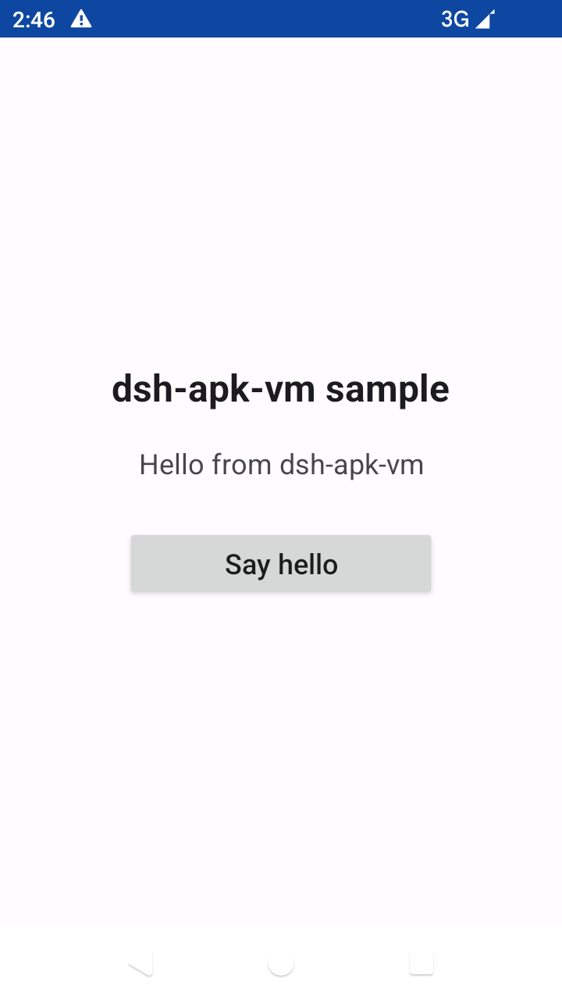

# Reproducible demo: build a 12 KB APK and drive `dsh-apk-vm`

This directory is a self-contained public demo for the `dsh-apk-vm` plugin. It
contains a tiny MIT-licensed Android app, a deterministic build that uses only
the Android SDK command-line tools, and a Node script that drives the documented
plugin HTTP API from **VM state** to **installed app**, **UI inspection**,
**button tap**, **text assertion**, and **screenshot**.

No Gradle, AndroidX, npm dependencies, or browser automation are involved.



## Contents

| Path | Purpose |
| --- | --- |
| `sample-apk/src/dev/dsh/sample/MainActivity.java` | One Activity; framework classes only. |
| `sample-apk/res/` | Layout, strings and a framework Material theme. |
| `sample-apk/AndroidManifest.xml` | Package `dev.dsh.sample`, launcher Activity. |
| `sample-apk/build.mjs` | Reproducible build: `aapt2` → `javac` → `d8` → ZIP → `zipalign` → `apksigner`. |
| `sample-apk/dsh-sample.apk` | The committed 12,566-byte APK built by that script. |
| `sample-apk/demo-public.keystore` | Public, throwaway demo signing key (not a secret). |
| `sample-apk/LICENSE` | MIT license for the sample sources and APK. |
| `demo.mjs` | End-to-end HTTP demo; no plugin internals imported. |

## Quick start (no Android SDK needed)

1. Start DSH, enable **APK Virtual Machine**, start the VM if needed, and wait
   until the panel reports the VM as **ready**.
2. From the repository root, run:

   ```powershell
   node examples/demo.mjs
   ```

The committed APK is already built and signed, so this path only needs Node 20+
and a running DSH Web GUI with the plugin mounted.

### Expected output

This is a real run against an AOSP Android 14 VM at 720×1280
(`emulator-5558`). Node counts and tap coordinates depend on the display size.

```text
dsh-apk-vm reproducible demo
  base: http://127.0.0.1:59480
  apk:  examples/sample-apk/dsh-sample.apk (12566 bytes)

=== 1/6 Check VM state ===
  GET /apk-vm/state -> 200
  state=ready serial=emulator-5558 screen=720x1280 root=true

=== 2/6 Install and launch the sample APK ===
  POST /apk-vm/install {"path":"examples/sample-apk/dsh-sample.apk"}
  200 installed dev.dsh.sample ("dsh-apk-vm sample") launched=true

=== 3/6 Inspect UI and locate the button ===
  GET /apk-vm/debug/ui (polling until the Activity is visible)
  hierarchy: 9 nodes, rotation=0
  button "Say hello" bounds=[160,673][560,769] center=(360,721)
  status before tap: "Tap the button to greet the VM."

=== 4/6 Tap the button ===
  POST /apk-vm/input {"type":"tap","x":360,"y":721}
  200 tap accepted at (360, 721)

=== 5/6 Assert the resulting text ===
  GET /apk-vm/debug/ui (polling for "Hello from dsh-apk-vm")
  hierarchy: 9 nodes, rotation=0
  status after tap: "Hello from dsh-apk-vm"
  PASS exact result text found

=== 6/6 Save a screenshot ===
  GET /apk-vm/debug/screenshot
  saved examples/demo-out/screenshot.png (31184 bytes, 720x1280)

DEMO PASSED
  VM:         emulator-5558 (ready)
  package:    dev.dsh.sample
  tap:        (360, 721)
  assertion:  "Hello from dsh-apk-vm"
  screenshot: examples/demo-out/screenshot.png
```

`examples/demo-out/` is ignored by Git. The demo exits non-zero and prints the
HTTP status plus response body if any step fails. It leaves the sample app
running; it never starts, stops, restarts or snapshots the VM.

The install line above is abbreviated for readability: the script prints the
repository-relative APK path, while the JSON body sent to the plugin contains
the absolute host path. The screenshot byte count includes the VM status bar
clock, so it can change between runs.

### Options

```text
node examples/demo.mjs [--base <url>] [--apk <file>] [--out <dir>] [--timeout <sec>]
```

| Option | Default | Meaning |
| --- | --- | --- |
| `--base` | `http://127.0.0.1:59480` | DSH Web GUI origin. |
| `--apk` | `examples/sample-apk/dsh-sample.apk` | APK to install. |
| `--out` | `examples/demo-out` | Directory for `screenshot.png`. |
| `--timeout` | `120` | Per-request timeout in seconds. |

## Rebuild the APK from source

### Prerequisites

- Node.js 20 or newer.
- Android SDK with:
  - `build-tools;34.0.0` (`aapt2`, `zipalign`, `lib/d8.jar`, `lib/apksigner.jar`),
  - `platforms;android-34` (`android.jar`).
- JDK 17 with `java`, `javac`, `jar` and `keytool`.

The script discovers the SDK from `ANDROID_SDK_ROOT` (or `ANDROID_HOME`) and the
JDK from `JAVA_HOME` (or `javac` on `PATH`). Replace the example paths below
with your local installation roots:

```powershell
# Windows PowerShell
$env:ANDROID_SDK_ROOT = 'C:\Android\sdk'
$env:JAVA_HOME = 'C:\Program Files\Java\jdk-17'
node examples/sample-apk/build.mjs
```

```bash
# Linux / macOS
export ANDROID_SDK_ROOT="$HOME/Android/Sdk"
export JAVA_HOME="/path/to/jdk-17"
node examples/sample-apk/build.mjs
```

Explicit paths work too:

```powershell
node examples/sample-apk/build.mjs --sdk C:\Android\sdk --java-home "C:\Program Files\Java\jdk-17"
```

### Expected build output

```text
dsh-apk-vm sample APK builder
  platform:    android-34
  build-tools: 34.0.0
  min SDK:     24
  output:      examples/sample-apk/dsh-sample.apk

[1/8] aapt2 compile
[2/8] aapt2 link + R.java
[3/8] javac (framework-only Java sources)
[4/8] d8 (classes.jar -> classes.dex)
[5/8] package classes.dex (fixed ZIP timestamps)
[6/8] zipalign -p 4
[7/8] apksigner (v2 + v3, public demo key)
[8/8] verify, inspect, copy into place

APK built successfully
  file:        examples/sample-apk/dsh-sample.apk
  bytes:       12566
  sha256:      4465ef8b06e4654d26e9312377d85796acbc4a5f5a2a31939cd51519e6557e9a
  package:     dev.dsh.sample
  version:     1.0.0
  activity:    dev.dsh.sample.MainActivity
  signatures:  v2=true v3=true v1=false (public demo key)
```

### What the build does

1. **`aapt2 compile`** compiles the XML resources to a flat resource archive.
2. **`aapt2 link`** links the manifest/resources against `android.jar`,
   generates `R.java`, and writes the resource-only APK.
3. **`javac`** compiles the Activity and `R.java` against `android.jar` only
   (`-source 8 -target 8`); there is no classpath besides the framework.
4. **`d8`** converts the class files to `classes.dex` (min API 24).
5. A small built-in ZIP writer adds `classes.dex`, preserves the compressed
   resource entries, and pins every ZIP timestamp to `2020-01-01 00:00:00`.
6. **`zipalign -p 4`** aligns entries for the platform.
7. **`apksigner`** signs with the committed public demo key using APK Signature
   Scheme v2 and v3. JAR/v1 signing is disabled, which is why the sample's
   `minSdkVersion` is 24.
8. The script verifies the signature, reads the badging with `aapt2 dump`, prints
   the SHA-256, and copies the signed APK into place.

### Reproducibility

The inputs, version code and version name are fixed, ZIP timestamps are pinned,
and no timestamped v1 signature is added. Two clean builds with the same
toolchain therefore produce the same bytes:

```powershell
node examples/sample-apk/build.mjs
(Get-FileHash examples/sample-apk/dsh-sample.apk -Algorithm SHA256).Hash
node examples/sample-apk/build.mjs
(Get-FileHash examples/sample-apk/dsh-sample.apk -Algorithm SHA256).Hash
```

Both builds report:

```text
4465EF8B06E4654D26E9312377D85796ACBC4A5F5A2A31939CD51519E6557E9A
```

On Linux/macOS use `sha256sum examples/sample-apk/dsh-sample.apk` instead. The
byte-identical result was verified with build-tools 34.0.0, platform 34,
JDK 17.0.2 and Node 24; a different SDK build-tools or zipalign version may
produce a different but equally valid APK.

The keystore is a **public, throwaway test key** — store/key pass `android`,
alias `dsh-sample`. It is intentionally committed so the checked-in APK can be
reproduced. Never use it for a real app. If you delete it, `build.mjs` generates
a new one and prints a warning, but the resulting APK will have a different
signature and hash.

## API surface used

All routes are same-origin and loopback-only, as documented in the plugin
README. This demo does not change any plugin files and needed no new routes.

| Step | Request | Observable result |
| --- | --- | --- |
| 1 | `GET /apk-vm/state` | `vm.state`, `vm.serial`, `screen.width/height`, `vm.root`. |
| 2 | `POST /apk-vm/install` `{"path":"<absolute-or-visible path>"}` | Installs with `adb install -r`, launches the Activity, returns `packageName`, `label`, `launched`. |
| 3 | `GET /apk-vm/debug/ui` | `{ok,nodes,rotation,xml}` UIAutomator dump. The demo finds `dev.dsh.sample:id/hello_button` and `dev.dsh.sample:id/status`, then computes the button center from its `bounds`. |
| 4 | `POST /apk-vm/input` `{"type":"tap","x":360,"y":721}` | Device-pixel tap via `adb shell input tap`. |
| 5 | `GET /apk-vm/debug/ui` | Polls until the status node text is exactly `Hello from dsh-apk-vm`. |
| 6 | `GET /apk-vm/debug/screenshot` | PNG download; the demo validates the PNG signature and writes the file. |

Notes:

- There is no `/apk-vm/debug/inspect` route in the current API. `/apk-vm/debug/ui`
  is the UI-inspection endpoint; `/apk-vm/debug/screenshot` is the screenshot
  endpoint.
- The demo installs by host path because it runs on the same machine as DSH. For
  a browser or a remote client, `POST /apk-vm/upload` with the raw APK bytes and
  an `x-apk-name` header is the documented alternative.
- The tap endpoint takes device pixels. Do not confuse it with `/apk-vm/touch`,
  which consumes video-frame coordinates for the H.264 stream.
- A VM that is not `ready` fails at step 1 with guidance; an install already in
  progress returns HTTP 409 with the exact body printed by the demo.

## Troubleshooting

| Symptom | Cause / fix |
| --- | --- |
| `DEMO FAILED: ... Is the DSH Web GUI reachable ...` | Wrong `--base`, DSH not running, or plugin not mounted at this origin. |
| `HTTP 403 cross-origin request rejected` | The route is loopback-only. Run the demo on the DSH host and use `127.0.0.1`, not a LAN address. |
| `VM is not ready (state=stopped)` | Open the APK Virtual Machine panel and press **Start VM**, then rerun. |
| `HTTP 409 another APK install is already running` | Another tab/agent is installing. Wait and rerun. |
| `timed out ... waiting for the "Say hello" button` | App did not launch or UIAutomator is busy. Check the VM screen/panel, unlock the device, rerun. |
| `aapt2 ... failed to open directory` during build | `aapt2` can mishandle non-ASCII absolute paths; the script already passes relative paths for its own files. Keep the SDK path ASCII. |

## License

- `sample-apk/` sources and the sample APK: MIT, see
  [`sample-apk/LICENSE`](sample-apk/LICENSE).
- `demo.mjs` and this document are part of the repository and use the
  repository's Apache-2.0 license.
